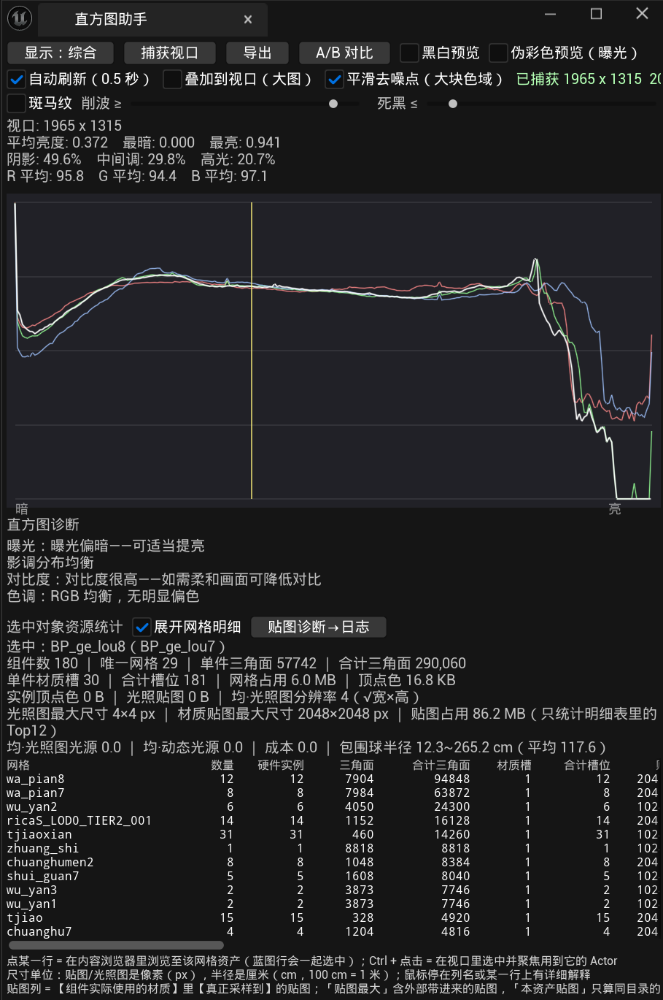
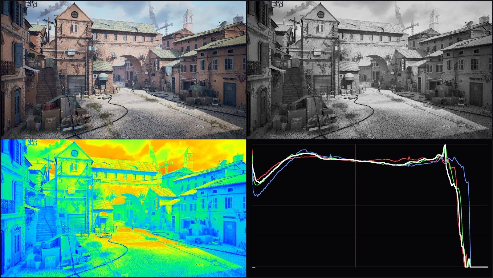
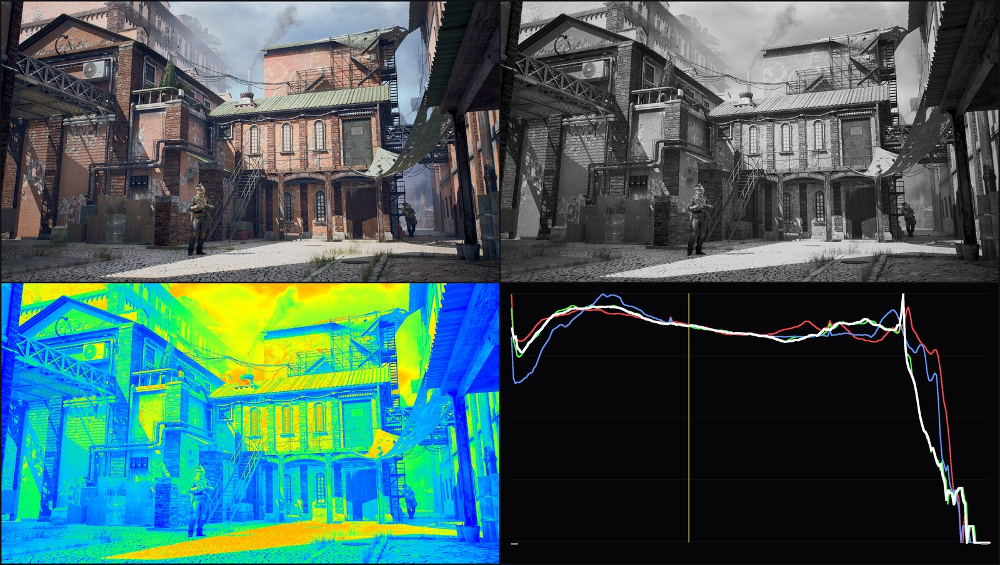

# Histogram Assistant · 直方图助手

> 一个 Unreal Engine 5 编辑器插件：实时分析活动视口的曝光与影调，帮你在调光时把"感觉对"
> 变成"数值对"。附带伪彩色曝光、斑马纹削波提示、A/B 帧对比、四合一导出与选中对象资源统计。

An UE5 editor plugin for exposure / tonal analysis of the active viewport. It reads the viewport
image, plots RGB & luma histograms, diagnoses exposure and colour cast, and offers false-colour
(IRE), zebra clipping, A/B frame comparison, 4-in-1 PNG export and per-selection asset statistics.

> **状态**：UE 5.5 已验证可用 · 仅编辑器模块（不影响打包出的游戏）

---

## 为什么做这个

做场景灯光时，判断"这张图曝光对不对、影调够不够通透"通常靠眼睛。
引擎自带的 `Primitive Stats` / `Texture Stats` 又把数字分散在几个窗口里，
来回切换会打断调光节奏。

这个插件把这些东西收进一个可停靠面板：一张直方图 + 一句"哪里不对、往哪调"的诊断。

---

## 功能

### 直方图与诊断
- 抓取**活动 3D 视口**画面，计算 R / G / B / 亮度直方图（对数归一化）
- 统计：平均 / 最暗 / 最亮亮度、阴影 / 中间调 / 高光占比、平均 RGB
- 三种显示模式：**综合**（四曲线叠加）、**RGB 独立**（各占一行，避免互相压扁）、**亮度**
- 自动诊断并给建议：曝光（不足 / 偏暗 / 正常 / 偏亮 / 过度）、影调比例、对比度、色调偏移
- 手动「捕获视口」或「自动刷新（0.5 秒）」
- **平滑去噪点（大块色域）**：开启后曲线做平滑，适合看大块明暗关系；关掉看原始分布
- **叠加到视口（大图）**：把直方图叠到视口上，不占面板空间

### 曝光辅助
- **伪彩色（IRE）**：按 RED 官方档位给画面上色 —— 紫=死黑、绿=18% 中灰、粉=肤色、红=削波，
  非关键档显示灰度，只给"显示副本"上色，**不污染直方图统计**
- **斑马纹**：超过「削波 ≥」或低于「死黑 ≤」的区域显示红/蓝斜纹，可与伪彩同开
- **黑白预览**：临时挂一个饱和度=0 的后处理，只看明暗；关闭即还原，不写进关卡

### 对比与导出
- **A/B 帧对比**：存一张参考帧，改灯光后切换 并排 / 擦除 / 差异，窗口可拖到副屏
- **四合一导出**：一键导出 `*_combined.png`（原图 / 灰度 / 伪彩 / 直方图）

### 选中对象资源统计
- 选中拼装蓝图实例，统计**三角面数、贴图尺寸与体积、光照图尺寸**
- 口径对齐引擎官方 `Primitive Stats` / `Texture Stats`，数字能对上
- 明细行可点击：在内容浏览器里跳到该资产；`Ctrl+点击` 在视口里选中并聚焦
- 贴图按**材质实际采样**统计（`GetUsedTextures`），并标注"不在本资产目录"的外部贴图

---

## 截图

**面板本体** —— 直方图 + 自动诊断 + 选中对象资源统计：



上图里能直接看到工具的工作方式：

- 顶部一行是**视口尺寸与统计**（平均亮度 0.372、阴影 49.6% / 中间调 29.8% / 高光 20.7%）
- 中间是**直方图**，左端「暗」右端「亮」，勾选平滑后曲线更易读
- 下面给出的**诊断结论**可以直接照做：「曝光偏暗——可适当提亮」「对比度很高——如需柔和画面可降低对比」
- 底部是**选中对象统计**：这个蓝图实例 180 个组件、29 个唯一网格、合计 290,060 三角面、
  贴图占用 86.2 MB，并按网格逐行列出，点一行就跳到对应资产

> 注意「贴图占用 86.2 MB（只统计明细表里的 Top12）」这句——统计口径写清楚，
> 避免看到数字就误以为是整场景总和。

**四合一导出**（原图 / 去色 / 伪彩色 / RGB-亮度直方图）——一张图看完整条分析链路：





这两张能直接读出问题。对伪彩色格做像素统计：

| 档位 | 拱门视角 | 主街视角 | 说明 |
|---|---|---|---|
| 红（削波） | **0.0%** | **0.0%** | 高光没有撞死，不需要压高光 |
| 紫（死黑） | **0.0%** | **0.0%** | 暗部也没有压死，细节都在 |
| 橙 / 黄（高光） | 8.3% | 4.7% | 高光还有余量 |
| 绿（18% 中灰） | 17.3% | 12.6% | 中灰基准点偏低 |
| 青 / 蓝（暗部） | **49.7%** | **61.2%** | 近半到六成像素落在暗部 |

结论不是"高光爆了"，而是**整体偏暗**：主街视角有 61% 的像素待在暗部，
高光区反而是空的。该做的是抬中间调和暗部，而不是收高光——这类判断靠眼睛很容易做反。

搭配直方图看更直接：曲线右端是垂直落下的（高光没过渡），
左端却堆得很高（暗部大量堆积），和伪彩色的统计完全对得上。

---

## 安装

### 方式一：下载预编译包（推荐，不需要 C++ 环境）

到 [Releases](../../releases) 下载对应引擎版本的 zip，解压后：

1. 双击 `1-安装到某个工程.bat`，把工程文件夹拖进去回车
   （或手动把 `HistogramAssistant` 复制到 `<你的工程>/Plugins/`）
2. 打开工程 → `Tools（工具）→ 直方图助手`

也可以装到引擎级：把文件夹放到 `<引擎>/Engine/Plugins/Marketplace/`，
再在 `Edit → Plugins` 里勾选。

### 方式二：从源码编译

```bat
"C:\Path\To\UE_5.5\Engine\Build\BatchFiles\RunUAT.bat" BuildPlugin ^
  -Plugin="D:\Path\To\HistogramAssistant.uplugin" ^
  -Package="D:\out\HistogramAssistant" ^
  -TargetPlatforms=Win64
```

> 编译前必须关闭编辑器（`Unable to build while Live Coding is active`）。
> 注意：**链接失败会删掉旧 DLL**，失败后要立刻修好重编，否则插件加载失败、面板消失。

---

## 兼容性

| 引擎版本 | 状态 |
|---|---|
| UE 5.5 | ✅ 已编译并实测 |
| UE 5.3 / 5.4 / 5.6 | ⚠️ 理论上可用，需自行编译（C++ 插件与引擎版本二进制绑定，无法跨版本共用 DLL） |

---

## 用法

1. 打开一个 3D 视口并保持激活
2. `Tools → 直方图助手`，面板可拖到侧边停靠
3. 点「捕获视口」或勾选「自动刷新」

需要看明暗关系时开「黑白预览」；判断死黑/削波时开「伪彩色」或「斑马纹」；
调光前后对比用「A/B 对比」。

---

## 开发中踩过的坑（值得一看）

这些是真实踩过、并且**能在引擎源码里找到依据**的问题，记录下来避免重复踩：

**1. `UTexture2D::UpdateTextureRegions` 不拷贝 `Regions` 指针**

引擎只做 `RegionData->Regions = Regions;` 把指针存下来，直到渲染线程才解引用。
如果在栈上构造 `FUpdateTextureRegion2D` 再传地址，函数返回后内存失效，
渲染线程读到垃圾 pitch，最终在 RHI 线程崩溃：
`Interfaces.CopyCommandList->Close() failed ... E_INVALIDARG`。

**症状极具迷惑性：崩溃栈里没有任何插件帧**（命令是异步执行的）。
正确做法是区域对象放堆上，在清理回调里和像素缓冲一起释放。

**2. `FViewport::ReadPixels` 返回的 alpha 恒为 0**

编辑器视口的 alpha 没有意义，但直方图只读 RGB 所以一直没暴露。伪彩色里"非关键档"沿用
`FColor(Gray, Gray, Gray, C.A)`，结果这些像素在 Slate 里**完全透明**，透出底下真实场景，
看起来像"伪彩没覆盖模型、只有边缘有零散色块"。

定位靠的是统计：截图上中性灰占比 **0.00%**——如果灰度档真的生效，画面里应该有大量纯灰像素。
最终在抓图源头统一强制 `A = 255`。

**3. 面板报 8192×8192，但模型看起来只有 1K**

一度怀疑是自己算错。用 PowerShell 直接读 uasset 字节串，抽出材质实例的贴图参数，
发现该实例的 `AO` 槽位仍指向另一个资源包的 8K 贴图——**插件没算错，是资产引用了外部贴图**。
这个结论避免了去修一个不存在的 bug。

**4. 伪彩色曾经被误判为"与编辑器视口不兼容"**

真实原因是材质图里没把 `SceneTexture` 节点接到 Custom 节点的命名输入，
导致 `NEEDS_SCENE_TEXTURES` 宏为 0，`SceneTextureLookup` 根本没生成；
编译失败又被引擎降级成 Warning 并回退到 `DefaultPostProcessMaterial`，
于是满屏单色**被误当成"伪彩色生效"**。

现在的实现改成纯 CPU 在抓图后上色，从根上绕开 shader 编译链。

---

## 目录结构

```
HistogramAssistant/
├─ HistogramAssistant.uplugin
├─ Source/HistogramAssistant/
│  ├─ HistogramAssistant.Build.cs
│  ├─ Public/HistogramAssistantModule.h
│  └─ Private/
│     ├─ HistogramAssistantModule.cpp    模块注册、菜单
│     ├─ HistogramCapture.cpp            视口抓图与直方图统计
│     ├─ HistogramPanel.cpp              主面板 UI（含诊断逻辑）
│     ├─ HistogramFalseColor.cpp         伪彩色（IRE 档位）
│     ├─ HistogramZebra.cpp              斑马纹削波
│     ├─ HistogramComparePanel.cpp       A/B 帧对比窗口
│     ├─ HistogramExport.cpp             四合一 PNG 导出
│     └─ HistogramSelectionStats.cpp     选中对象资源统计
└─ docs/
   ├─ 安装与使用.md
   └─ 开发日志.md                        完整开发过程与排错记录
```

---

## 许可

MIT License，见 [LICENSE](LICENSE)。

---

## 致谢

开发过程中参考了 RED 官方的 False Color 档位定义与 UE5 引擎源码（`Texture2D.cpp`、
`StreamableRenderAsset.h` 等）。开发过程完整记录在 [docs/开发日志.md](docs/开发日志.md)。
